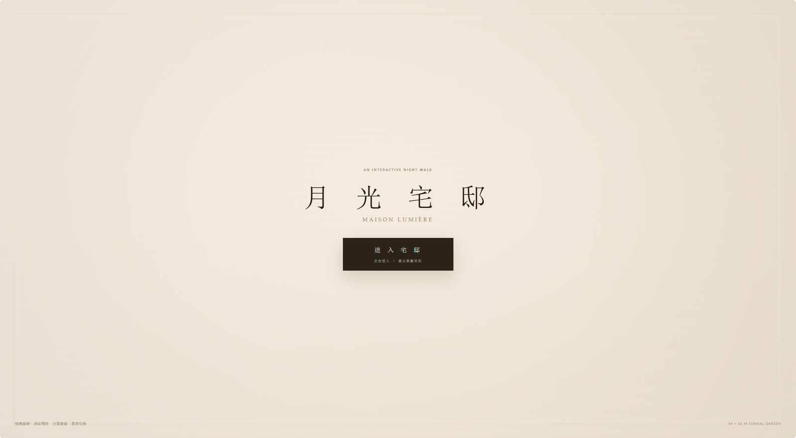
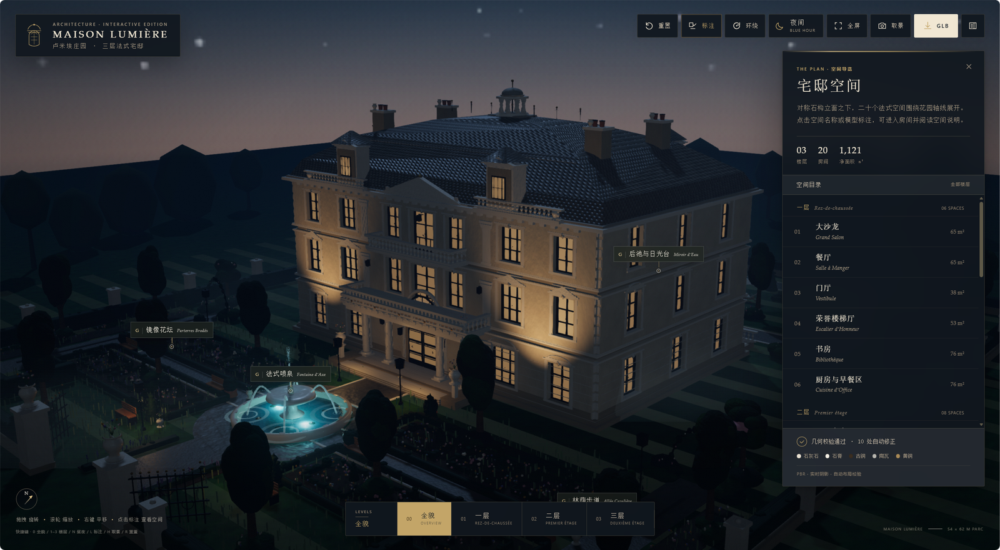
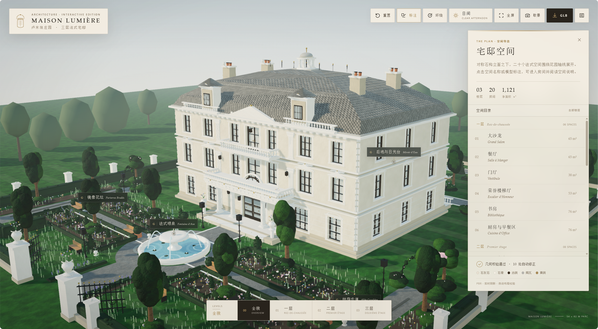
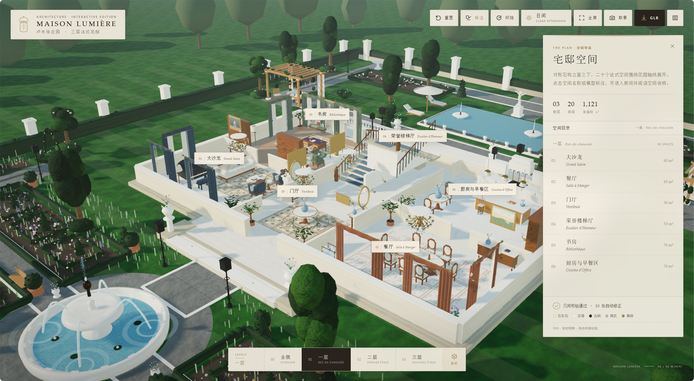
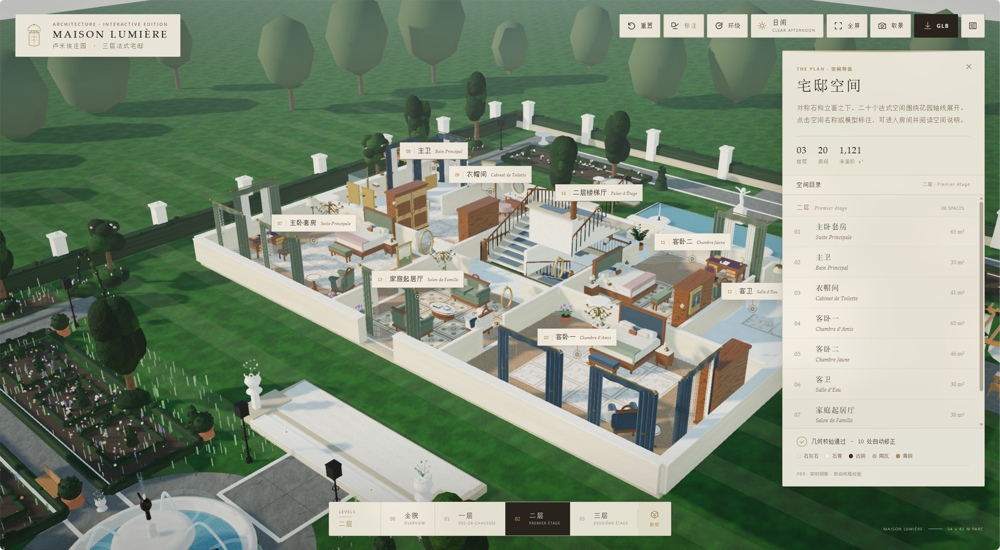
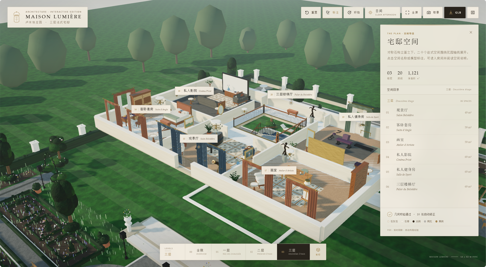

# 月光宅邸 MAISON LUMIÈRE · 卢米埃庄园

> 基于 Three.js 的三层法式宅邸交互式 3D 漫游网页  
> An interactive Three.js walkthrough of a three-storey French manor at blue hour.



**月光宅邸**是一座对称石构立面的三层法式庄园：二十个法式空间沿花园中轴展开，室内净面积 **1,121 ㎡**，前庭由喷泉、镜像花坛、林荫步道和远景树林共同围合。项目以**单文件 HTML** 交付，打开浏览器即可在月光下漫游整座庄园。

无需安装、无需构建。点击「进入宅邸」后，贝多芬《月光奏鸣曲》第一乐章与 31.7 秒夜间开场运镜同时开始。

---

## ✨ 功能特性

- **🎬 电影级开场运镜**：大门外低位缓推穿门 → 立面竖摇抬升 → 庄园全貌 360° 环绕 → 后拉抬升俯瞰 → 复位默认机位；全程 31.7 秒，连续 ease-in-out，无静止停顿。
- **🌗 昼夜双模式**：夜间 **Blue Hour**（冷月光、暖窗、水下灯）与日间 **Clear Afternoon**（暖阳、清透天空）一键切换。
- **🏢 三层剖切查看**：全貌 / 一层 / 二层 / 三层；低墙剖切保留完整空间关系。
- **🪟 20 个空间标注**：大沙龙、餐厅、门厅、荣誉楼梯厅、书房、主卧套房、私人影院、画室、私人健身房等，点击标注或右侧目录即可定位并查看面积、说明与材质色谱。
- **⛲ 法式喷泉与花园**：中央水柱、四向弧线水柱、落水飞溅、连续涟漪、水雾、池底冷光；花园包含近景草叶、花头、镜像花坛、林荫步道与后池。
- **🌙 PBR 与夜间光影**：石灰石、石膏、古铜、陶瓦、黄铜等 PBR 材质；桌面端月光软阴影、实时环境反射、Bloom 与冷雾景深。
- **🎵 内嵌背景音乐**：贝多芬《月光奏鸣曲》第一乐章（Noble Music Project 演奏），base64 分块内嵌，30% 音量循环，点击「进入宅邸」时与开场同步开始。
- **📦 GLB 导出与取景**：顶部一键导出通用 GLB；`H` 进入沉浸取景模式，隐藏界面方便截图。
- **🖥️ 单文件离线运行**：HTML 内含 3D 数据、PBR 贴图与音频；不依赖 CDN、外部音频或本地服务器。
- **🧭 白屏兜底**：WebGL 初始化失败、上下文丢失或长时间无有效渲染帧时，页面中央显示「如白屏或无法显示，请点击右上角用系统浏览器打开」。

---

## 🖼️ 效果预览

### 夜间 / 日间全貌

| 夜间 Blue Hour | 日间 Clear Afternoon |
|:---:|:---:|
|  |  |

### 楼层剖切

| 一层 | 二层 |
|:---:|:---:|
|  |  |

| 三层 |
|:---:|
|  |

> 预览图已统一压缩至 1600px 宽（原始截图为 2549×1403），以控制仓库体积。

---

## 🚀 快速开始

**无需构建、无需安装依赖。**

1. 下载仓库中的 [`manor.html`](manor.html)。
2. 使用 **Chrome / Edge / Safari** 等现代浏览器打开。
3. 等待加载完成后，点击「**进入宅邸**」。
4. 背景音乐与 31.7 秒夜间开场运镜同时开始；开场结束后 UI 在 0.8 秒内淡入，恢复全部交互。

> 首次打开约 38.2 MB，包含 3D 场景与内嵌音乐，加载需要一点时间。  
> 微信或低配设备如白屏/无声音，请点击右上角 `···` → 在系统浏览器打开。

如果浏览器限制本地 HTML，可在成品目录启动静态服务：

```bash
python -m http.server 8080
# 浏览器打开 http://localhost:8080/manor.html
```

---

## 🎮 交互操作

| 操作 | 方式 |
|---|---|
| 旋转视角 | 鼠标左键拖拽 |
| 缩放 | 滚轮 / 双指捏合 |
| 平移 | 鼠标右键拖拽 / 双指拖动 |
| 全貌 / 一层 / 二层 / 三层 | 底部楼层条，或 `0` / `1` / `2` / `3` |
| 墙体剖切 | 一层及以上显示「剖切」按钮，或 `C` |
| 房间定位 | 点击画面空间标注，或右侧「宅邸空间」目录 |
| 关闭房间卡 | 房间卡右上角关闭，或 `Esc` |
| 昼夜切换 | 顶部夜间/日间按钮，或 `N` |
| 显示/隐藏标注 | 顶部「标注」，或 `L` |
| 自动环绕 | 顶部「环绕」按钮 |
| 重置视角 | 顶部「重置」，或 `R` |
| 沉浸取景 | 顶部「取景」，或 `H` |
| 全屏 | 顶部「全屏」 |
| GLB 导出 | 顶部「GLB」按钮 |
| 背景音乐 | 无独立控件；点击「进入宅邸」后自动开始 |

开场运镜期间所有 UI 隐藏，相机旋转、缩放、平移和快捷键暂时锁定；结束后全部恢复。

---

## 🛠️ 技术栈

| 层 | 实现 |
|---|---|
| 3D 渲染 | **Three.js 0.180**、PBR 材质、实时阴影、环境贴图、Bloom、FXAA |
| 场景加载 / 导出 | `GLTFLoader`、`GLTFExporter`、`OrbitControls` |
| 后期处理 | `EffectComposer`、`RenderPass`、`UnrealBloomPass`、`ShaderPass`、`OutputPass` |
| 相机动画 | 原生 `requestAnimationFrame` + 自研 ease-in-out 时间线（**未引入 Tween.js / GSAP**） |
| UI / 样式 | 原生 HTML / CSS / JavaScript，无前端框架 |
| 程序化材质 | Canvas 生成 PBR 贴图（石材、灰泥、木地板、织物、草地、水面等） |
| 构建工具 | Node.js、esbuild、`@napi-rs/canvas`、`@gltf-transform/*` |
| 质量校验 | ESLint、Khronos glTF Validator、自定义 8 项场景校验 |

---

## 📁 项目结构

```text
.
├── manor.html                    # 最终单文件成品（推荐下载）
├── 法式别墅-交互式3D.html         # 同一成品，中文文件名版本
├── index.html                    # 同一成品，网页入口版本
├── index-external.html           # 外部 GLB 轻量入口（需 HTTP 服务）
├── maison-lumiere-villa.glb      # 独立 glTF 2.0 模型
├── screenshots/                  # README 展示截图
│   ├── 01-cover.png              # 启动页
│   ├── 02-night.png              # 夜间全貌
│   ├── 03-day.png                # 日间全貌
│   ├── 04-floor1.png             # 一层剖切
│   ├── 05-floor2.png             # 二层剖切
│   └── 06-floor3.png             # 三层剖切
├── src/                          # viewer / 建筑 / 花园 / 材质源码
├── scripts/                      # 构建、优化、组装、校验脚本
├── output/                       # bundle、manifest、validation 产物
└── README.md                     # 项目说明
```

> `manor.html`、`法式别墅-交互式3D.html` 与 `index.html` 是三份内容一致的最终成品；日常分享优先使用英文文件名 `manor.html`。

---

## 📐 项目规格

| 项目 | 数据 |
|---|---|
| 建筑 | 三层法式宅邸，对称石构立面 |
| 室内空间 | **20 个空间**，净面积 **1,121 ㎡** |
| 庭院 | 约 **2,900 ㎡** 法式园林 |
| 最终 HTML | **38.22 MB**（含内嵌音乐与 3D 数据） |
| 独立 GLB | **24.51 MB**（25,696,456 bytes） |
| 三角面 / 顶点 | 1,166,192 / 933,696 |
| 材质 / 贴图 | 81 个材质 / 41 张贴图 |
| 开场时长 | **31.7 秒**，全程夜间，连续运镜 |
| 自动校验 | **8 / 8 通过**，Khronos glTF Validator **0 errors** |

---

## ⚠️ 说明

- **首次加载**：页面约 38 MB，桌面端首次加载需要数秒至十余秒；移动端取决于网络。加载完成后才会出现「进入宅邸」。
- **音乐触发**：浏览器自动播放策略要求一次用户手势。点击「进入宅邸」同时启动音乐与开场，因此音乐从镜头第一帧开始；页面没有音乐开关或播放状态。
- **月光阴影**：桌面端启用 2048 月光软阴影；移动端为帧率关闭月光阴影，但仍保留冷月光、环境反射与暖窗对比。
- **微信分享**：微信内置浏览器可能白屏或限制音频。页面已提供中央提示；建议复制链接到系统浏览器打开。
- **背景音乐授权**：贝多芬原曲属于公有领域；**Noble Music Project** 的演奏录音由项目提供者提供，公开部署或再发行前请自行确认录音使用授权。
- **字体**：页面依赖系统字体（宋体 / Georgia 等），不请求外部字体文件。
- **测试说明**：项目采用静态构建与 glTF 校验；实际 WebGL 光影、粒子密度和移动端帧率建议在目标设备上做最终视觉确认。

---

## 🙏 说明与致谢

- 场景、建筑、家具、花园、材质与交互逻辑均为本项目程序化生成与手工实现。
- 背景音乐：**贝多芬《月光奏鸣曲》第一乐章**（Piano Sonata No. 14, Op. 27 No. 2, I. Adagio sostenuto），演奏 **Noble Music Project**。
- 若本项目对你的 Three.js 建筑可视化有帮助，欢迎 Star 或 Fork。
